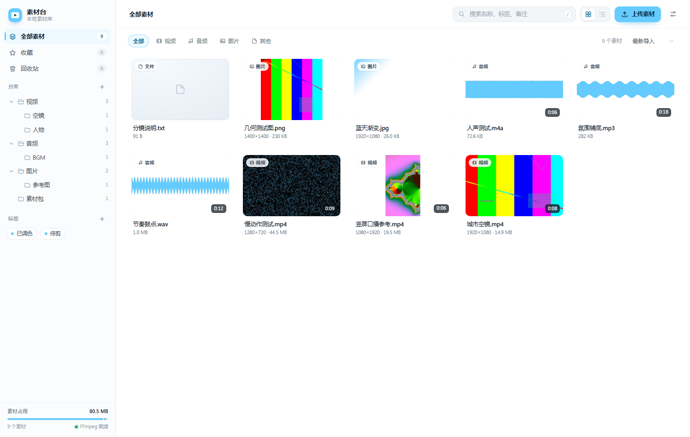
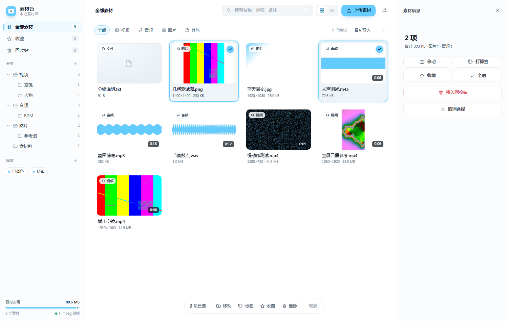
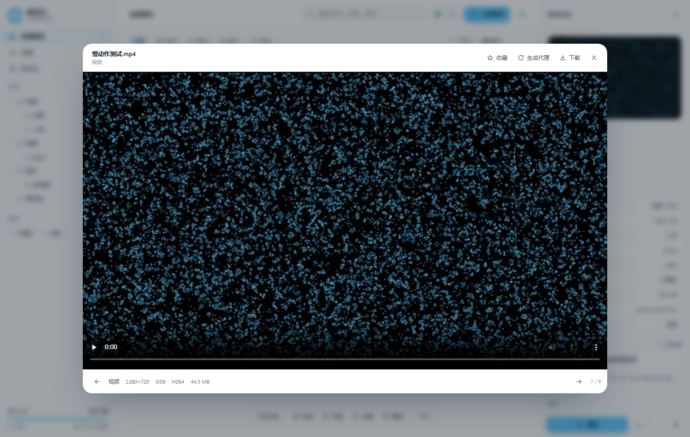
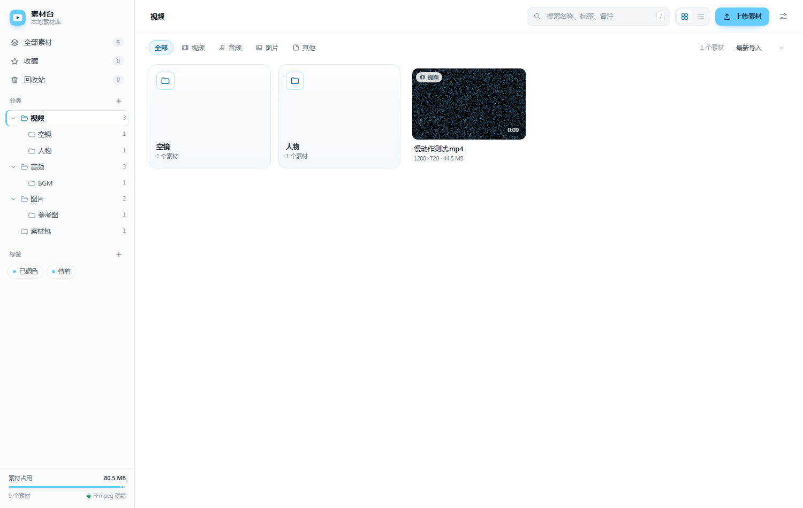
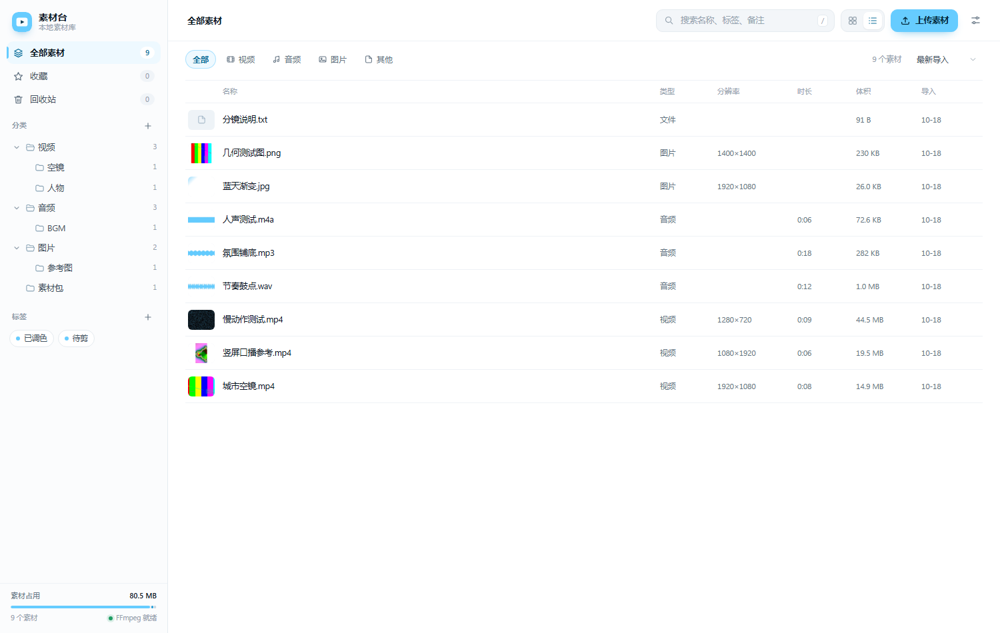
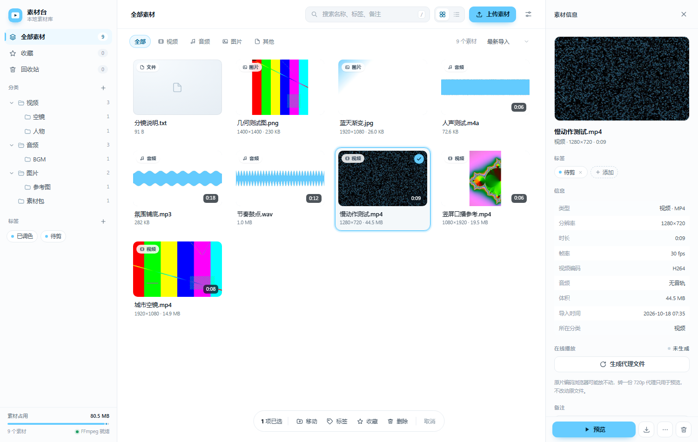
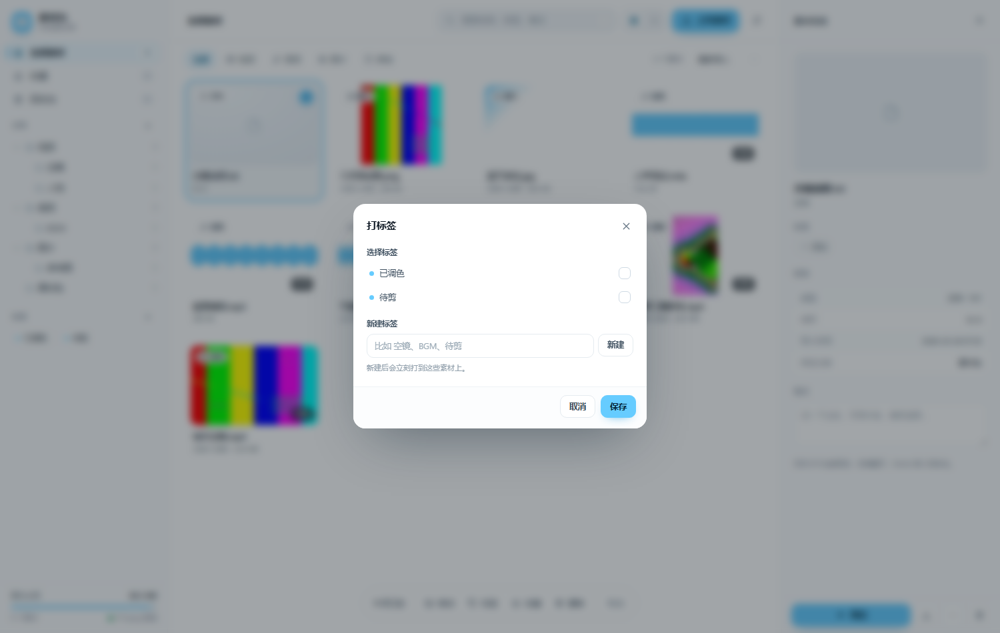

# 素材台 · Material Desk

给自己用的本地素材库。视频、音频、图片、参考文件统一入库，按分类和标签管理，点开就能看，需要的时候直接拖进剪辑软件。

纯本地运行，素材不出这台机器；不需要数据库服务，也不需要前端构建。



## 功能

- **上传入库**：拖进窗口任意位置即可，支持整个文件夹；8MB 分片、断点续传、可暂停，几百 MB 的大文件也不会一把梭。上传视频前会弹确认框，选分类、顺手改个名。
- **分类**：任意层级的目录树，新建 / 改名 / 移动 / 删除，磁盘目录同步变化。
- **标签**：多对多，一个素材可以有多个标签，跨分类筛选。
- **两种视图**：网格看画面，列表看时长、体积、分辨率、导入时间。
- **缩略图**：视频抽帧、图片缩放、音频封面或波形图，后台队列生成，页面实时更新。
- **元数据**：时长、分辨率、帧率、编码、码率、音轨，卡片和详情里都能看到。
- **在线播放**：本地 Range 流，进度条可拖动；浏览器不认的编码可一键生成 720p 代理。
- **整理**：多选、批量移动、批量打标签、收藏、备注、重命名，删除进回收站可还原。
- **右键与拖拽**：空白处右键新建分类（建在当前分类；选中素材时建在这些素材所在的分类里，并一起移进去）/ 上传 / 刷新；文件夹方块右键打开 / 重命名 / 删除；卡片右键整套操作；素材拖到文件夹方块或左侧分类也能移动。
- **快捷键**：搜索、全选、预览翻页、播放暂停、收藏，全键盘可用。

## 界面

| 多选与详情 | 视频预览 |
| --- | --- |
|  |  |

| 文件夹 | 列表视图 |
| --- | --- |
|  |  |

| 素材详情 | 打标签 |
| --- | --- |
|  |  |

## 快速开始

要求：Windows（主要开发环境）、Python 3.11 或更新版本。

```bat
python -m pip install -r requirements.txt
python run.py
```

也可以直接双击 **`启动.bat`**。默认打开 <http://127.0.0.1:8420>，只监听本机。

想让同一局域网的手机或平板访问，双击 **`启动-局域网.bat`**（或 `python run.py --lan`）：

- 同时监听 IPv4 和 IPv6，窗口里会把可用地址都打印出来
- 端口默认 **8420**，手机连同一个网络，复制窗口里的地址打开即可
- IPv6 地址会随拨号 / 重连变化，以启动窗口打印的为准
- 第一次启动记得在 Windows 防火墙弹窗里选「允许访问」

窗口关掉服务就停。

## FFmpeg

缩略图、媒体信息、代理文件都依赖 FFmpeg。查找顺序：

1. 设置页里手动填的路径
2. 系统 `PATH` 里的 `ffmpeg`
3. `imageio-ffmpeg` 自带的便携版

三样都没有时网站照常可用，只是视频没有缩略图、不能转代理。装好之后在「设置 → 重建全部缩略图」跑一次即可。

Windows 可以直接下 <https://www.gyan.dev/ffmpeg/builds/> 的 release essentials 包，解压后在设置里指向 `ffmpeg.exe`。

## 目录结构

```
平台/
├─ run.py               启动器（选端口、开浏览器）
├─ app/                 后端
│  ├─ config.py         路径与设置
│  ├─ db.py             SQLite 表结构与文件路径换算
│  ├─ media.py          FFmpeg 探测 / 缩略图 / 代理
│  ├─ jobs.py           后台队列 + SSE 广播
│  └─ main.py           HTTP 接口
├─ web/                 前端（原生 ES Module，无构建）
│  ├─ index.html
│  ├─ css/app.css
│  └─ js/               按功能拆分的模块
├─ library/             素材本体，按分类建目录
├─ data/                索引、缩略图、代理、配置
│  ├─ library.db
│  ├─ thumbs/
│  ├─ proxies/
│  └─ config.json
├─ docs/                截图
├─ tools/               测试与示例数据脚本
├─ 使用说明.md
└─ 启动.bat
```

`library/` 和 `data/` 都不进版本库，见 `.gitignore`。

## 快捷键

| 按键 | 作用 |
| --- | --- |
| `/` 或 `Ctrl+K` | 聚焦搜索 |
| `Ctrl+A` | 全选当前列表 |
| `Delete` | 移入回收站 |
| `空格` / `Enter` | 预览 |
| `←` `→` | 预览里切上一个 / 下一个 |
| `空格` | 预览里播放 / 暂停 |
| `F` | 预览里收藏 |
| `Esc` | 关闭弹层 / 取消选择 |

## 实现要点

- **后端**：FastAPI + SQLite（标准库 `sqlite3`，无 ORM），同步接口跑在线程池，目录树用链表结构存 `parent_id`。
- **前端**：原生 ES Module + CSS，没有打包步骤、没有 CDN 依赖，改一行刷新就生效。
- **上传**：前端按 8MB 切片，`PUT /api/uploads/{id}/{index}` 落盘，最后服务端拼装入库；失败重试会从服务端已收到的分片继续。
- **缩略图 / 转码**：两条 `asyncio` 队列，快队列做探测和抽帧，慢队列做代理转码，互不阻塞；完成后通过 SSE 把新状态推给页面。
- **播放**：自己实现 HTTP Range 响应，视频可以随意拖动；代理文件转好前也能先看原片。
- **路径**：`library_root / 分类链路 / 文件名`，所以分类改名、移动会同步移动磁盘目录，删库重建不会丢素材。

主要接口：

| 接口 | 说明 |
| --- | --- |
| `GET /api/bootstrap` | 目录树、标签、统计、设置 |
| `GET /api/files` | 列表，支持目录、类型、标签、搜索、排序、分页 |
| `POST /api/files/bulk` | 批量移动 / 删除 / 还原 / 打标签 / 收藏 |
| `POST /api/uploads` | 创建分片上传 |
| `GET /api/files/{id}/stream` | Range 流（`?proxy=1` 走代理） |
| `GET /api/events` | SSE，推送缩略图与转码进度 |

## 开发与测试

```bat
python run.py --no-browser
python tools/selfcheck.py   # 干净环境自检：上传、缩略图、回收站
python tools/smoke.py       # 更全的接口回归
python tools/seed_demo.py   # 生成一批示例素材，看看填满的样子
```

测试用的示例素材会在第一次运行时自动生成，不需要提交二进制文件。

## 已知限制

- 只能通过页面上传入库，直接往 `library/` 拷文件不会被索引（后续可加「扫描素材库」）。
- 分类里还有素材或子分类时不能删除，需要先移走；这是为了避免误删连带清掉记录。
- 代理转码是单线程队列，一次只处理一个。
- 没有登录和权限，默认只监听本机；用 `--lan` 开放给局域网时请自己注意网络环境。
- 还没做：悬停扫帧、波形时间轴、重复文件检测、合集 / 项目分组。

## 备份与迁移

整个目录复制走就是完整备份。只想要素材就复制 `library/`，想连标签、备注、元数据一起备份再加 `data/library.db`。

换机器时把整个目录拷过去，装好依赖，双击 `启动.bat` 即可；素材在库里的相对路径不会变。
